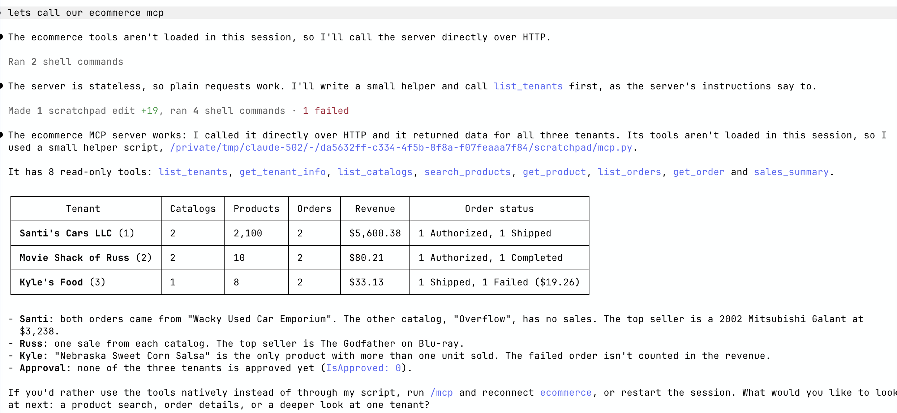
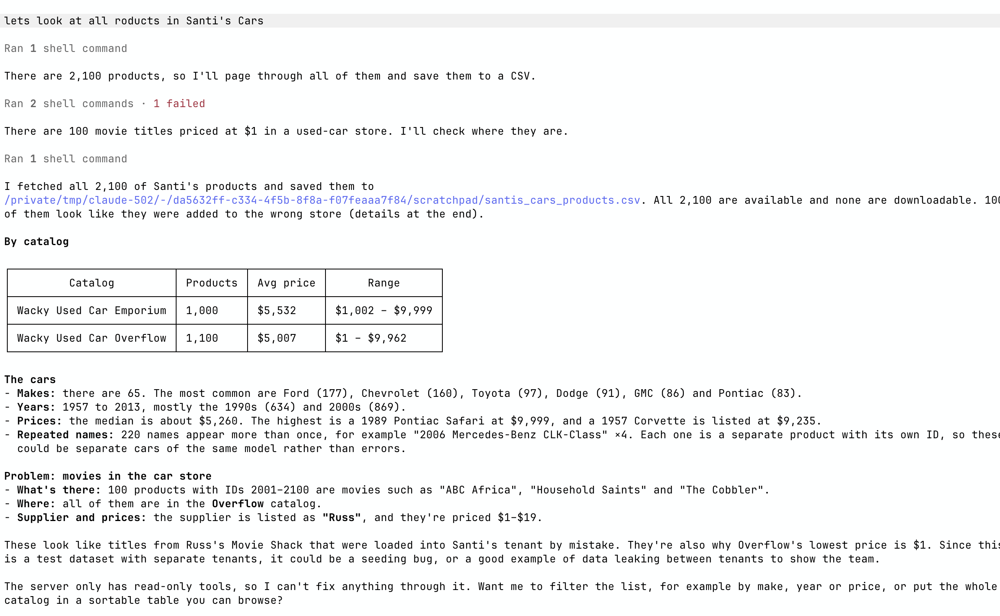

# MCPDemo2 — Multi-tenant eCommerce MCP servers

A series of MCP (Model Context Protocol) servers that expose the **eCommerce Core** SQLite database to
Claude Desktop. Each one runs locally over **Streamable HTTP**, exposes the same tools, and is
implemented in a different stack, so you can compare them side by side.

| Version | Stack            | Port   | Folder    | Status  |
|---------|------------------|--------|-----------|---------|
| 1       | Node.js (JS, ESM) | `6500` | `node/`   | ✅ built |
| 2       | .NET / C#        | `6501` | `dotnet/` | planned |
| …       | (future)         | `6502–6505` | | |

## Direction

- **One database, many tenants.** The tenant is the **Seller**. Each seller owns Catalogs, which own
  Products. Orders carry `SellerId` directly. Every query filters on the seller, so a tenant can only see
  its own data.
- **Pick a tenant, then pass it on every call.** The client calls `list_tenants`, then passes `tenantId`
  to every data tool (`list_orders`, `search_products`, and so on). A call without a valid `tenantId` fails.
- **The connection controls which tenants are allowed.**
  - `/mcp` gives access to all tenants (admin/demo mode), so `list_tenants` returns everyone.
  - `/mcp/<sellerId|username>`, or `/mcp` with an `X-Tenant-Id` header, locks the connection to one tenant.
    `list_tenants` returns only that tenant, and any other `tenantId` is rejected.
- Asking for another tenant's product or order id returns "not found".
- **Read-only.** The database is opened read-only, and every tool is marked `readOnlyHint`.
- **Stateless HTTP.** Each POST builds a new server bound to the tenant. There are no sessions.
- **Same contract in every version.** Tool names, inputs, and output shapes should match across stacks.

### Tenants in the demo database

| Id | Username | Name                | Data |
|----|----------|---------------------|------|
| 1  | `santi`  | Santi's Cars LLC    | 2 catalogs, 2,100 products (2,000 used cars + 100 misfiled movies, see below), 2 orders |
| 2  | `russ`   | Movie Shack of Russ | 2 catalogs (physical + downloadable), 10 movies, 2 orders |
| 3  | `kyle`   | Kyle's Food         | 1 catalog, 8 food products, 2 orders (1 failed) |

`db/db.sqlite` is a copy of `eCommerce-Core/TempFiles/Database/db.sqlite`. The original only had data for
seller 1, so `db/seed-tenants.sql` (idempotent) adds data for sellers 2 and 3. It has already been applied.

### Tools

| Tool              | Purpose |
|-------------------|---------|
| `list_tenants`    | Tenants available on this connection. Every other tool requires an `Id` from here as `tenantId` |
| `get_tenant_info` | The seller's name plus counts of catalogs, products, and orders |
| `list_catalogs`   | The tenant's catalogs with product counts |
| `search_products` | Text, catalog, supplier, price range, and availability filters, with paging |
| `get_product`     | Full detail for one product |
| `list_orders`     | Newest first, with optional `status` (`Created`, `Authorized`, `Captured`, `Shipped`, `Completed`, `Failed`) and `catalogId` filters |
| `get_order`       | One order with its lines |
| `sales_summary`   | Revenue by catalog and by status, plus the top 5 products (Failed orders excluded) |

## Running the Node version

Requires Node 22.13+. It uses the built-in `node:sqlite`, so there are no native modules to build.

```bash
cd node
npm install
npm start          # http://localhost:6500 (override with PORT=...)
npm test           # in another terminal: smoke test + tenant-isolation checks
```

`GET http://localhost:6500/` lists the tenants and their MCP URLs.

## Connecting Claude Desktop

Claude Desktop launches local servers over stdio, so use [`mcp-remote`](https://www.npmjs.com/package/mcp-remote)
to bridge to the local HTTP server. Add one entry per tenant to
`~/Library/Application Support/Claude/claude_desktop_config.json`:

```json
{
  "mcpServers": {
    "ecommerce-node": {
      "command": "npx",
      "args": ["-y", "mcp-remote", "http://localhost:6500/mcp", "--allow-http"]
    },
    "ecommerce-node-russ-only": {
      "command": "npx",
      "args": ["-y", "mcp-remote", "http://localhost:6500/mcp/russ", "--allow-http"]
    }
  }
}
```

Start the server first, then restart Claude Desktop. Some prompts to try:

- "What tenants are there?"
- "Show me Russ's orders." (Claude calls `list_tenants`, then `list_orders` with `tenantId: 2`)
- "Find Volvos under $3,000 for Santi's Cars."
- "Compare sales across all tenants."
- On `ecommerce-node-russ-only`: "Show me Santi's orders." Only Russ is listed, and `tenantId: 1` is rejected.

## Example sessions

These are real sessions against the Node server on port 6500.

### 1. Overview of every tenant

> **Prompt:** "lets call our ecommerce mcp"

Claude called `list_tenants`, then `get_tenant_info` and `sales_summary` for each tenant:

| Tenant | Catalogs | Products | Orders | Revenue | Order status |
|---|---|---|---|---|---|
| Santi's Cars LLC (1) | 2 | 2,100 | 2 | $5,600.38 | 1 Authorized, 1 Shipped |
| Movie Shack of Russ (2) | 2 | 10 | 2 | $80.21 | 1 Authorized, 1 Completed |
| Kyle's Food (3) | 1 | 8 | 2 | $33.13 | 1 Shipped, 1 Failed ($19.26) |

It also noted the top seller for each tenant, that the failed order isn't counted in revenue, and that no
seller is approved yet (`IsApproved: 0`).



### 2. Browse one tenant's products

> **Prompt:** "lets look at all products in Santi's Cars"

Claude paged through all 2,100 products with `search_products` (`tenantId: 1`, `limit: 100`, increasing
`offset`), saved them to a CSV, and summarized them:

| Catalog | Products | Avg price | Range |
|---|---|---|---|
| Wacky Used Car Emporium | 1,000 | $5,532 | $1,002 – $9,999 |
| Wacky Used Car Overflow | 1,100 | $5,007 | $1 – $9,962 |

- **Makes:** 65 in total. The most common are Ford (177), Chevrolet (160), Toyota (97), Dodge (91), GMC (86) and Pontiac (83).
- **Years:** 1957–2013, mostly from the 1990s and 2000s. The median price is about $5,260.
- **Data problem it spotted:** 100 products (IDs 2001–2100) in the Overflow catalog are **movies** with the
  supplier set to "Russ", priced $1–$19.



> **About the movies in Santi's store:** these 100 rows are in the **original** eCommerce Core database
> (`Products.CatalogId = 2`, `SupplierName = 'Russ'`). The seed script didn't add them, and they don't
> mean the server leaks data between tenants: every query filters correctly on `SellerId`, and the data
> itself is filed under the wrong seller. It makes a good demo of an AI noticing a data-quality problem.
> We left the data as is on purpose.

## Layout

```
db/        db.sqlite (copied + seeded), seed-tenants.sql
docs/      screenshots for the README
node/      v1 – Node.js MCP server (port 6500)
  src/server.js   HTTP + tenant resolution + tool registration
  src/db.js       tenant-scoped queries
  test/smoke.js   end-to-end + isolation test
```
